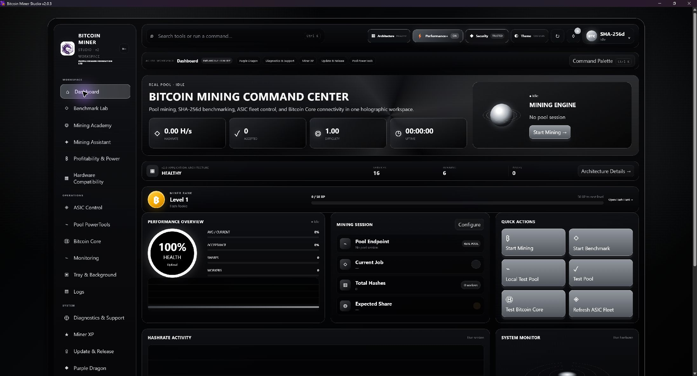
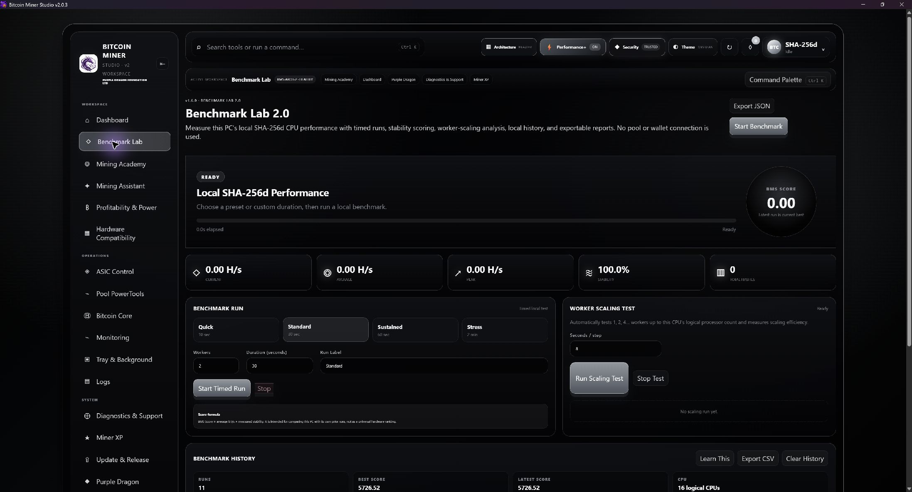
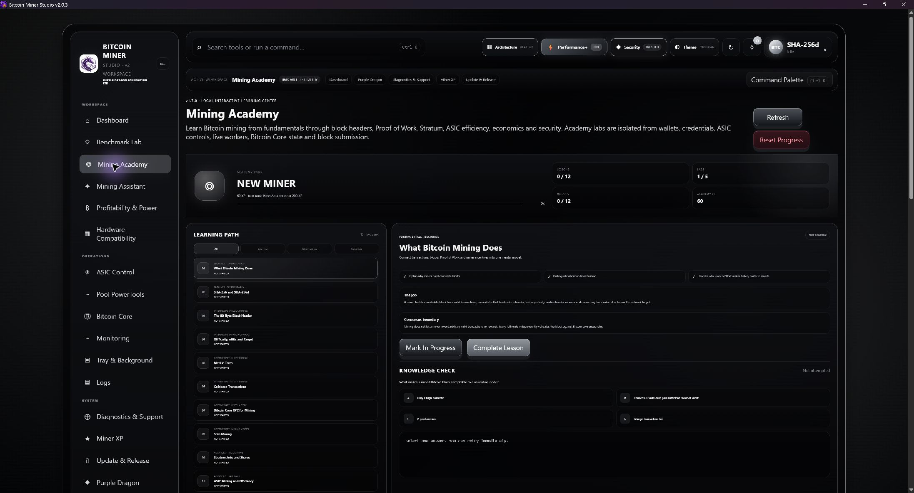

# Bitcoin Miner Studio

A local-first Windows x64 workspace for SHA-256d CPU benchmarking, pool mining, Bitcoin Core integration, authorized ASIC monitoring, diagnostics, and mining education. Published by **Purple Dragon Foundation ltd**.

## Download v2.0.3 Workspace QoL

[Windows x64 ZIP](https://github.com/bubblegump30/bitcoin-miner-studio/releases/download/v2.0.3-workspace-qol/BitcoinMinerStudio-v2.0.3-Workspace-QoL-Windows-x64.zip) · [SHA-256 checksums](https://github.com/bubblegump30/bitcoin-miner-studio/releases/download/v2.0.3-workspace-qol/SHA256SUMS-Windows.txt) · [Release notes](https://github.com/bubblegump30/bitcoin-miner-studio/releases/tag/v2.0.3-workspace-qol)

1. Compare the ZIP's SHA-256 with `SHA256SUMS-Windows.txt` (expected: `1637324436e4aded5cb4c0cc46790c3ebabb515b24ae13e69aba76dc19118c52`).
2. Extract it into a new folder and run `BitcoinMinerStudio.exe` on Windows 10/11 x64. Microsoft Edge WebView2 Runtime is required; Python is included.
3. Open **Purple Dragon Security** and confirm **TRUSTED · 82/82 protected source files** before using critical mining controls.

The EXE has no Microsoft Authenticode signature. The Purple Dragon manifest is publisher-signed and checks the protected files; the ZIP checksum checks the downloaded archive.

## Screenshots

| Benchmark Lab | Mining Academy |
| --- | --- |
|  |  |

## What's in the app

- **Mining and profiles:** local SHA-256d CPU mining, Stratum pool profiles, backups and failover, connection tests, and ASIC monitoring.
- **Bitcoin Core:** node dashboard, setup assistance, and controlled solo-mining tools.
- **Tools:** local benchmark lab, Mining Academy, diagnostics and sanitized support bundles, and signed-package inspection in Update & Release Center.
- **Workspace QoL:** shared mining controls, reliable Monitoring range changes, clearer refresh feedback, and keyboard navigation in the Command Palette.

The Workspace QoL Windows ZIP includes Braiins Pool and CKPool Solo. The integrated source on this branch also includes BTC PoW Lab. Selecting a preset only previews it; applying BTC PoW Lab changes the primary endpoint while leaving worker, password, backups, failover, and the ordinary fee assumption as entered. Its 85/10/5 hybrid reward allocation cannot be represented by the generic fee estimate. Review [preset sources and limitations](docs/POOL_PRESETS.md) and current provider terms before mining. No pool is selected or endorsed automatically.

## Guides and project information

- [Complete v2.0.3 user guide](docs/USER_GUIDE.md) — setup, profiles, testing, mining, and troubleshooting
- [Pool preset documentation](docs/POOL_PRESETS.md) · [Mining safety](MINING_SAFETY.md) · [Changelog](CHANGELOG.md)
- [Historical project notes](docs/README_HISTORY.md) · [Older release and upgrade docs](docs/archive) — detailed older feature and design descriptions
- [Purple Dragon Foundation website](https://www.purpledragonfoundationltd.xyz/)

Mining rewards and profit are never guaranteed. Pool access, compatibility, and payout terms depend on the provider. The app does not silently start mining, download updates, or upload support bundles.
